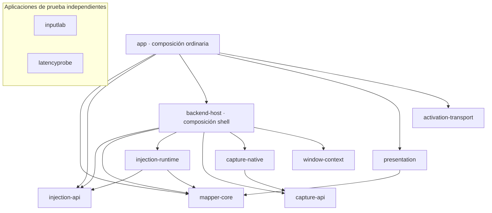

# Arquitectura de UwU Mouse

La aplicación separa el plano de control, los eventos físicos, el mapeo y la
inyección. Flutter controla juegos, perfiles, permisos y estado. Los movimientos
del mouse y contactos táctiles se procesan en los módulos nativos, sin pasar por
Dart ni por un canal de métodos en cada evento.

El inventario verificable está en [architecture/modules.json](architecture/modules.json).
`python tools/check_architecture.py` comprueba las dependencias Gradle, sus ciclos,
los límites de importación, la exclusión de aplicaciones de prueba y el prefijo
estable del contrato Binder. Requiere Python 3.9 o posterior, sin dependencias.

## Interfaz y plano de control

| Carpeta Flutter | Responsabilidad |
|---|---|
| `lib/app/` | Composición, aplicación y tema |
| `lib/application/ports/` | Puerto `MapperGateway` |
| `lib/application/models/` | Estado, comandos y modelos del plano de control |
| `lib/application/controllers/` | Coordinación de acciones explícitas, como iniciar un perfil |
| `lib/application/policies/` | Reglas de preparación de sesión |
| `lib/platform/android/` | Implementación `MethodChannelMapperGateway` |
| `lib/features/` | Pantallas de biblioteca, conexión y activación |
| `lib/shared/widgets/` | Componentes visuales compartidos |

Las pantallas reciben `MapperGateway`; `MobiMapperApp` selecciona su implementación.
Una implementación distinta se inyecta en esa composición sin cambiar las
pantallas. El adaptador Android conserva el canal `dev.mobimapper/control.v1`, los
nombres de comandos y el protocolo 1 de los mapas de estado. Las features no
instancian `MethodChannel` ni importan el adaptador Android.

`ProfileLauncher` coordina una acción solicitada por el usuario y comprueba que
sigue vigente. Volver del segundo plano no debe reproducir una acción cancelada
ni restaurar teclas o botones mantenidos.

## Módulos Android y dirección de dependencias

El inventario contiene **13 proyectos Gradle**: diez participan en el APK de
producción, dos son laboratorios independientes y uno es el host de validación.
Las flechas del siguiente DAG significan **depende de**. La lista completa y
exacta, incluido el host de validación, se comprueba contra Gradle.



| Módulo | Contenido y límite |
|---|---|
| `mapper-core` | Kotlin/JVM puro: motor, compositor multitáctil, perfiles, compilación/validación, almacenamiento de cola, políticas y modelos de recuperación/editor. Sin Android, Flutter, dispositivos o Binder. JSON se compila sin empaquetar otra implementación en Android. |
| `capture-api` | Contratos Kotlin de proveedor, dispositivos, eventos físicos, estado y lease. Sin tipos Android. |
| `capture-native` | Adaptador `ShellEvdevCapture` y lector C++/JNI evdev. Selección de dispositivos, reloj monotónico, exclusividad y terminación acotada. |
| `injection-api` | AIDL compartido: `IInjector`, `IBackendEvents` e `IPhysicalInputCallback`. No implementa lectura ni inyección. |
| `injection-runtime` | `InjectionWorkerMain`, `WorkerConnection` y consulta excepcional del estado táctil del dispatcher. Solo depende de core y API, sin captura ni descubrimiento de ventanas. |
| `window-context` | `WindowContextProvider`, caché shell de metadatos WMS y parser conservador. Sin lectura de vistas ni dependencia de accesibilidad. |
| `backend-host` | Raíz de composición privilegiada: `ShellMain`, `BackendIdentity`, `SupervisedInjector` y `NativeCaptureBroker`. Conecta captura, contexto, transporte, autorización y recuperación. |
| `presentation` | Editor, burbuja, controles y cursor. Consume modelos y puertos de presentación; no descubre servicios de captura, coordinadores o almacenes de la app. |
| `activation-transport` | Protocolo ADB local, claves, emparejamiento/TLS y su puente nativo. La app decide cuándo puede activarse el servicio. |
| `app` | Raíz de composición con UID ordinario: `MapperApplication`, Activity/canal, servicios Android, `NativeSessionHost`, coordinación de sesión/juego y adaptadores de persistencia. No depende directamente de las implementaciones físicas de captura o inyección. |

`inputlab` observa únicamente su propia ventana y tiene otra identidad Android.
`latencyprobe` es un experimento opcional de recepción/dibujo que compila el
recorder compartido por un sourceSet filtrado. Ninguna aplicación de prueba es
dependencia transitiva del APK de producción. El host de `android/platform-build`
también es de validación y no constituye un APK distribuible del mapeador.

## Contratos reemplazables

| Contrato | Implementación actual y punto de sustitución |
|---|---|
| `MapperGateway` | El adaptador Android se selecciona en `lib/app`. Conservar o versionar comandos y mapas de estado. |
| `SessionEnvironment` | El adaptador de `MapperRuntimeComposition` aporta backend, contexto, captura y admisión de frames. `SessionController` no descubre hosts ni registros concretos. |
| `SessionEvents` | La composición conecta cambios de sesión y solicitudes de editor con la presentación. Los diagnósticos de UI se ensamblan fuera del consumo de muestras. |
| `ProfileStorage` | `ProfileStore` aporta almacenamiento Android mediante `AtomicFile`. El motor consume perfiles preparados y no lee archivos por movimiento. |
| `CaptureProvider` | `ShellEvdevCapture`; el factory/adaptador del broker en `backend-host` conecta callbacks y estado nativo. Sustituir ese wiring y su dependencia sin cambiar UI o motor. |
| `IPhysicalInputCallback` | Entrega asíncrona de primitivas asociadas a una generación de captura, no objetos `MotionEvent` reciclables. |
| `IInjector` / `TouchFrame` | El supervisor adapta sesiones y frames a `WorkerConnection`. Un worker alternativo conserva el protocolo del transporte o cambia el adaptador dentro de la composición privilegiada. |
| `WindowContextProvider` | Caché `ShellWindowContextProvider`. Un reemplazo debe mantener frescura, propiedad, display y rechazo de metadatos incompletos. |
| `EditorPresentationHost` | La composición suministra admisión y marcos de ventanas separados de su representación visual. |
| `BubbleSettingsPort` | La app aporta la persistencia existente; la biblioteca visual solo lee y solicita guardar ajustes. |

La composición elige implementaciones concretas; los contratos no intentan ocultar
que el broker o el supervisor necesitan un adaptador para cada implementación.
No se deben añadir dependencias del motor a esos adaptadores para facilitar un
cambio particular.

## Composición y lógica de sesión en la app

`MapperApplication.attachBaseContext` enlaza `MapperRuntimeComposition` antes de
que se ejecuten providers, actividades o servicios. El enlace no abre dispositivos,
no inicia una sesión y no restaura entradas mantenidas. La misma composición
puede solicitar el enlace repetidas veces; una identidad diferente no puede
sustituir los puertos de una sesión viva dentro del proceso.

`SessionController` conserva el ciclo de vida, el worker y la cola del motor.
Consume `SessionEnvironment` para las capacidades externas y `SessionEvents`
para notificar cambios; ya no importa `NativeSessionHost`, `GameCoordinator`,
`BackendRegistry` ni `MainActivity`. El checker protege también ese límite de
fuentes, además del DAG de módulos. La admisión de inyección sigue consultando
el guard del contexto almacenado; no se añaden mapas de diagnóstico por movimiento.

El backend Binder permanece en `BackendRegistry` y la autorización de su provider
en `BackendProvider`. Las operaciones explícitas de juego están en `GameCommands`
y su arnés de diagnóstico shell en `GameDiagnostics`; ese arnés conserva la
comprobación de UID del provider antes de limpiar la identidad del llamador.
El detalle de paquetes y orden de inicio está en [android/app/README.md](android/app/README.md).

## Recorrido de entrada y procesos

```mermaid
flowchart LR
    Device["Dispositivo externo USB/Bluetooth"] --> Native["capture-native · evdev/JNI"]
    Native --> Broker["NativeCaptureBroker · shell UID 2000"]
    Broker --> Callback["IPhysicalInputCallback · captureId"]
    Callback --> Session["NativeSessionHost / SessionController · app"]
    Session --> Engine["mapper-core · perfil preparado"]
    Engine --> Touch[TouchFrame]
    Touch --> Binder[IInjector]
    Binder --> Supervisor["SupervisedInjector · shell"]
    Supervisor --> Pipe["WorkerConnection · pipe acotado"]
    Pipe --> Worker["InjectionWorkerMain · proceso aislado"]
    Worker --> Android["Android · UID y display autorizados"]
```



El proveedor y el broker no interpretan el perfil de un juego. El motor no abre
descriptores, el worker no conoce el mouse y la interfaz no recibe muestras
físicas. El compositor conserva un único flujo multitáctil y su journal registra
lo que pudo haberse entregado, incluso cuando se pierde una respuesta.

El lector evdev y su watchdog trabajan en hilos propios. El callback Binder de
captura es `oneway`; `NativeSessionHost` publica el trabajo en el hilo principal
y `InputQueue` lo serializa en el worker del motor. Los lotes reducen cruces
JNI/Binder y entradas de cola sin mezclar los bordes de teclas o botones. La
inyección continúa esperando su ACK de forma ordenada: el journal debe distinguir
lo confirmado de una entrega ambigua antes de continuar o cancelar el stream.
La presentación de vistas permanece en el hilo principal de Android. Esta
separación no significa que todas las operaciones sean asíncronas.

La captura nativa se ejecuta con la identidad shell ya autorizada mediante ADB;
el UID ordinario de la app no obtiene acceso directo a `/dev/input`. La autoridad
del provider autentica el registro del backend. Sus métodos Binder autentican al
UID de la aplicación antes de realizar operaciones privilegiadas.

## Inicio, propiedad y cierre

1. La app verifica capacidad nativa, permiso de superposición, destino, display,
   calibración y liberación anterior antes de armar la sesión.
2. El contexto shell debe estar vigente y contener una ventana de aplicación del
   paquete y UID esperados. Se rechazan foco ajeno, geometría inválida o una ventana
   superior que cubra el destino. La inyección conserva su comprobación de foco y
   destino independiente del parser de ventanas.
3. El broker selecciona dispositivos externos admitidos por identidad/capacidades.
   No captura la pantalla táctil ni presupone que el primer `eventN` es el mouse.
   El inicio exige una base de botones/teclas liberada.
   La selección automática admite todos los nodos de mouse relativo externos,
   incluidos los que publica un teclado compuesto. Sus botones se combinan para
   que un movimiento o UP de otro nodo no libere un botón mantenido. Un path de
   mouse explícito conserva la selección individual. El inventario de diagnóstico
   se actualiza al adquirir, sin consultar dispositivos por cada muestra.
4. El lector obtiene exclusividad mediante `EVIOCGRAB`: leer evdev sin ese grab no
   suprimiría la entrada original. Si falla una adquisición, se liberan las ya
   obtenidas. Los eventos se agrupan por `SYN_REPORT` y conservan CLOCK_MONOTONIC.
5. La app renueva la captura. El contrato acepta leases de 250–2000 ms, con 1500 ms
   por defecto. Pérdida del consumidor, caducidad, retirada del dispositivo,
   `SYN_DROPPED` o pérdida de contexto terminan la propiedad y exigen una sesión
   nueva; no se reconstruyen acciones mantenidas.
6. El cierre coordina devolución de dispositivos, liberación de teclas reenviadas
   y finalización/cancelación de contactos. Un ACK ambiguo o liberación no verificada
   mantiene el bloqueo correspondiente; no se presenta como una liberación segura.

Las teclas no asignadas también quedan suprimidas por un grab de teclado. Por eso
la app las reenvía explícitamente mediante `forwardKey`, restringido a la captura
activa y al destino autorizado. El backend conserva sus DOWN para emparejar UP y
tratar la liberación. No existe un reenvío genérico libre hacia otras apps.

Evdev no incorpora un display Android en cada muestra. `displayId` es el destino
explícitamente admitido y propiedad de la sesión, no un dato deducido del nombre
del mouse, de `eventN` o de sus coordenadas. Esto requiere nuevas pruebas físicas
para cada configuración de varias pantallas.

La detección admite capacidades de mouse relativo y botones en interfaces
separadas, teclados compactos, pads numéricos y controles multimedia externos.
Conserva las exclusiones de entradas internas, multitáctiles, gamepads y nodos
que sólo anuncian encendido/suspensión. Las huellas incluyen identidad y
capacidades para rechazar la reutilización de un nodo por otro dispositivo.
`LinuxKeyMap` prepara tablas por minor evdev al configurar la captura: busca
layouts instalados de vendor/product y nombre saneado en directorios del sistema,
con Generic como fallback. La consulta de una tecla no hace I/O. Los códigos no
resueltos se omiten y cuentan, sin inventar una tecla ni pausar todo el mapeador.
No implementa todos los HID usages, key character maps o políticas de layouts de
Android, por lo que no garantiza todos los idiomas o firmwares.

## Frecuencia de captura, muestras y entrega del motor

`camera.updateRateHz` conserva su campo y formato de perfil, pero ahora configura
`CaptureRequest.mouseRateHz` en el lector nativo. El control ofrece 100, 500,
1000 Hz y Libre (`0`); los valores históricos 60/90/120/144/240 siguen siendo
válidos y se conservan hasta una edición explícita. No se cambia el intervalo USB
o Bluetooth ni se deja de leer el kernel.

El C++ reúne el movimiento en un lote global, antes de JNI/Binder, con hasta 256
muestras que conservan identidad, deltas y timestamp monotónico originales. Un
plazo monotónico y `ppoll` permiten entregar el último movimiento sin un ticker
permanente. Libre no introduce espera de frecuencia; entrega el trabajo disponible
al acabar cada lectura acotada. Un lote de una sola muestra puede usar el callback
escalar. Las teclas y los bordes de botones vacían primero el movimiento pendiente
y se entregan inmediatamente, por lo que pueden producir entregas adicionales al
límite de movimiento. El cambio de límite despierta el lector sin reabrir nodos
ni restaurar botones mantenidos.

La cola conserva lotes originales en `RawMouseMotionBatch`, sin convertirlos en
un solo delta antes de `PrecisionAimFilter`. Cada X y timestamp originales pasan
por el filtro. La cámara continua puede sumar después del filtro; la cámara por
región integra cada muestra para conservar límites, inversiones y clamps de
disparo. `TouchComposer.beginMoveBatch/endMoveBatch` aplaza únicamente MOVE
redundantes durante un drenaje y puede abarcar varias entradas escalares o de
lotes. Se vacía al terminar el drenaje y antes de teclas, botones y cambios de
modo; BEGIN/END/handoff también vacían antes de cambiar contactos.

`discardMoveBatch` revierte sólo posiciones pendientes que no entraron al sink.
Una posición intentada con ACK ambiguo conserva sus coordenadas nuevas como
candidato de cancelación. CANCEL, pérdida de contexto o cambio de generación
descartan movimiento pendiente y no lo reproducen después. Los snapshots y
frames publicados siguen separados del almacenamiento mutable privado.

La mira precisa sólo actúa sobre X durante el disparo físico M1 reconocido. La
amortiguación máxima pasa de 0,45 a 0,50 y la estimación de velocidad de 12 a
14 ms; esa constante matemática no añade una espera. Y no cambia y los flicks
de magnitud igual o mayor a ocho unidades relativas pasan exactamente. Se
reutiliza el coeficiente exponencial exacto para intervalos repetidos.

Las explicaciones de los ajustes se publican desde un `?` en su misma fila. La
ayuda se representa dentro de la superposición existente, con hover del cursor
propio en menús y hover normal en el editor, además de pulsación táctil. No crea
otra ventana para cada tooltip. El alcance de las mediciones y las comprobaciones
está en Frecuencia y rendimiento (informe local no distribuido).

## Contexto de ventanas y presentación

El provider de contexto tiene un worker de 250 ms y una antigüedad máxima de 750 ms.
Los dumps `windows` y `displays` comparten un plazo de 500 ms y 4 MiB; los errores,
datos incompletos o ausencia de foco verificable producen `valid=false` y lista
vacía. `snapshot()` no realiza IO. Una lease de demanda de tres segundos suspende
los dumps cuando no quedan consumidores. La primera petición tras reposo debe
esperar un contexto nuevo antes de habilitar entrada.

`DumpCompletion` publica cada consulta únicamente después de terminar el lector
del pipe y el escritor Binder, y de liberar el indicador de operación activa.
La aceptación del escritor se comprueba tras esa barrera; un contador de tareas
en cero no basta para permitir el siguiente dump. Las regresiones fuerzan ese
orden entre hilos, la llegada del texto antes de la aceptación y el caso de una
operación ya completada cuyo plazo venció. Se conservan los límites de tiempo,
frescura y foco; las lecturas fallidas distinguen `dump_windows_unavailable` de
`dump_displays_unavailable`.

WMS es texto de implementación OEM, no una API estable ni una transacción atómica.
Se conservan únicamente paquete, UID, hashes locales, tipos, foco, orden y marcos.
Los títulos, vistas y dumps completos no se publican. Un marco de ventana no prueba
su área interna de contenido; se marca explícitamente cuando ambas coinciden por
falta de información verificable.

Todas las superposiciones de producción usan `TYPE_APPLICATION_OVERLAY` y el
permiso estándar `SYSTEM_ALERT_WINDOW`, tanto en el teléfono como en pantallas
externas. Las capas pasivas respetan su presupuesto combinado de opacidad. Editor,
menú, HUD y cursor dependen de `Context` y puertos; no de `AccessibilityService`.
El manifiesto de producción no declara un servicio de accesibilidad.

## Datos físicos y compatibilidad del protocolo

`PhysicalInputFrame` distingue `MOUSE` y `KEY`. Sus campos son:

- `eventTimeNanos`: origen monotónico del kernel, conservado separado de tiempos
  sintéticos o de recepción.
- `deviceId` y `devicePath`: identidad del nodo evdev, distinta del identificador
  `android.view.InputDevice`.
- `relX`, `relY`, `wheel`, `horizontalWheel`, `buttonState`: deltas y máscara de
  botones, sin perfil ni geometría del juego en el proveedor.
- `keyScanCode`, `keyDown`, `keyRepeat`: códigos Linux y bordes físicos; el adaptador
  de la app resuelve los códigos Android necesarios.

`CaptureRequest` contiene `targetPackage`, `displayId`, `mousePath`,
`keyboardPaths`, `leaseDurationMs`, `captureMouse`, `captureKeyboard` y
`mouseRateHz`.
`CaptureDevice` identifica `path`, `name`, `deviceId`, `bus`, `vendorId`,
`productId`, capacidades `mouse`/`keyboard`, teclas, ejes, botones, identidad
física/única y `initialButtons`.
`CaptureStatus` contiene `providerId`, estado `STOPPED/RUNNING/LOST`, `captureId`,
`leaseExpiresMonotonicNanos`, `devices`, `reason`, `targetPackage` y `displayId`.
Los callbacks Binder llevan el `captureId` opaco del broker;
un callback antiguo no pertenece a una sesión nueva. El ID interno del lector se
mantiene separado cuando aparece en diagnóstico.

`PhysicalMouseBatch` / `IPhysicalInputCallback.onMotionBatch` conservan arrays de
timestamps, IDs/path y deltas originales, con rueda y estado combinado de botones.
Los callbacks también conservan `onFrame` para bordes y entregas escalares y
`onCaptureLost` para pérdidas: son tres métodos, con los dos iniciales intactos.
El estado nativo distingue muestras leídas, entregadas, descartadas y pendientes,
paquetes, lecturas, barreras y el límite solicitado/aplicado.

Se conservan `dev.mobimapper.mobimapper`, el archivo `profiles-v1.json`, el esquema
9 de perfiles, las identidades de entrada shell/worker y el protocolo backend 4.
Los paquetes Kotlin permanecen estables aunque sus archivos se hayan movido entre
módulos. La retirada del antiguo servicio de accesibilidad es deliberada.

Las primeras **15 transacciones de `IInjector` mantienen orden, tipos y direcciones**.
Los métodos nuevos se agregan al final: captura, renovación, parada, estado,
contexto, teclas y notificaciones. El checker permite ese crecimiento y rechaza
insertar, quitar o cambiar una transacción del prefijo existente.
El contrato actual tiene **25 métodos `IInjector`**. Los dos últimos,
`startCaptureWithRate` y `setCaptureMouseRate`, añaden inicio/cambio de frecuencia;
la capacidad correspondiente se comprueba antes de usar un backend anterior.

El protocolo 4 por sí solo no demuestra que un backend antiguo tenga captura
nativa. `captureReady` exige la capacidad anunciada por el backend; la ausencia
del campo implica `false`. Flutter usa `captureReady`, `captureBackend` y
`captureError`, además de `overlayPermission`. El campo histórico `accessibility`
se conserva en el estado como `false` y no habilita controles. Estar preparado no
demuestra que un dispositivo concreto pueda adquirirse ni que el juego ya recibió
un gesto; esas verificaciones ocurren al iniciar y en las pruebas físicas.

## Validación y referencias

El checker estático se ejecuta con:

```sh
python tools/check_architecture.py
python tools/check_architecture.py --json
```

`scripts/Check-Architecture.ps1` compila los módulos y la composición de app con un
host Android independiente del plugin Flutter. La pasada inicial de esta
reestructuración reportó **500 pruebas JVM aprobadas**, sin fallos ni errores.
La verificación Flutter separada aprobó **59 pruebas**. El lector nativo se compiló
para cuatro ABI y la vista previa arrancó anunciando `captureReady=true`. Esas
comprobaciones de compilación/capacidad e inicio se complementaron con las pruebas
de dispositivo descritas a continuación; no acreditan todos los juegos o DeX.
El host de validación tampoco sustituye el build completo con Flutter fijado,
empaquetado, firma y pruebas de dispositivo.

La ruta nativa se validó en el teléfono con teclado y ratón **físicos**, sin
servicio de accesibilidad. En una misma captura y observación de InputLab, el
mapeador recibió 12 347 eventos de mouse y 565 de teclado, incluidos 12 085
movimientos relativos, y registró 12 857 inyecciones. El receptor independiente
registró 3311 callbacks táctiles, cero errores de secuencia y ninguna fuga de
mouse ni WASD asignado durante esa observación. Las teclas sin asignación se
reenviaron deliberadamente. Al detener, quedaron cero contactos y ninguna
liberación de teclas sin verificar. Estos contadores miden etapas distintas y
no implican una correspondencia de uno a uno entre eventos y callbacks Android.

La corrección posterior para DeX incorpora 16 pruebas de selección y botones de
dispositivos compuestos y diez de entrega de cámara, para **526 pruebas JVM** en
total. En cámara continua sin límite de frecuencia, cada drenaje del worker
agrupa después del filtro de precisión hasta ocho entradas dentro de ocho ms de
sus timestamps de origen. El drenaje entrega al terminar, sin temporizador ni
cambio de frecuencia del perfil. Teclas, botones y cambios de modo vacían antes
el movimiento; pausa, pérdida de contexto o cambio de generación lo descartan.
Se mantiene una única tarea de drenaje durante la entrega síncrona. Las cámaras
por región, el laboratorio y las frecuencias explícitas conservan sus políticas.

El cursor propio también puede pertenecer al menú de controles con el juego
pausado. Esa captura sólo despacha a widgets propios, conserva DOWN/UP y arrastre,
agrupa los MOVE de widgets por frame y descarta clics fuera de la interfaz o sobre
ventanas que la cubren. El editor conserva la entrada normal de Android. La
presentación del puntero tiene propietarios separados de sesión y captura:
cerrar la inyección no devuelve el puntero del sistema mientras un menú conserva
el mouse. Las pérdidas se correlacionan por ID de captura para no afectar a un
reemplazo. En esa etapa, nueve pruebas adicionales llevaron el total a **535 pruebas JVM**.

La mejora posterior de frecuencia/compatibilidad y mira precisa aprobó **571
pruebas JVM**, **59 pruebas Flutter** con análisis sin errores y **12
comprobaciones C++**. El guard JSON revisó **113 clases**. En una medición física
del lector a 100 Hz se observaron 480 muestras originales/s y 96,26 entregas/s;
al terminar, las 40 760 muestras originales estaban entregadas, sin pendientes
ni descartes. El límite previo Libre se restauró sin modificar perfiles. Esa
medición corresponde al APK de prueba del lector. El APK final ya está instalado;
los perfiles y la selección del preview y del APK original coinciden antes y
después de la actualización. El editor permaneció abierto más de 30 segundos,
sin contactos, captura o error de metadatos y con presentación autorizada. El
usuario confirmó el selector 100/500/1000/Libre, hover de `?` y Guardar a 500 Hz.
La captura posterior está activa en DeX con límite solicitado/aplicado de 500 Hz,
sin descartes, muestras pendientes ni liberaciones sin verificar. El único cambio
de perfil es la frecuencia guardada de 0 a 500; se conservan selección y demás
perfiles. En Entrenamiento, el usuario aprobó la estabilidad algo mayor al disparar
M1 con movimientos pequeños y la conservación de los giros rápidos. Esta prueba
corresponde al G502 y teclado USB usados en DeX y no certifica cada modelo. Al
terminar, el usuario dejó el editor abierto, sin sesión activa, contactos,
captura o errores; el perfil conserva 500 Hz y precisión habilitada.
No mide polling USB ni latencia hasta imagen.

La corrección posterior de estabilidad de cámara suma 19 regresiones y aprobó
**590 pruebas JVM**; el guard JSON revisó **114 clases**. En cámara continua,
`CameraIdlePolicy` mide 80 ms de quietud desde recepción local y último ACK.
El host requiere generación/contexto vigentes, colas y pacer vacíos, puente
nativo sin callbacks/muestras pendientes y ningún botón de mouse mantenido.
Sólo retira el ID 9 si salió del display o acumuló recorrido L1 de dos veces la
dimensión mayor; tras el ACK se restablece el ancla y el siguiente movimiento
abre un nuevo contacto. Se conservan los otros dedos, su `downTime`, captura y
modo; no se emite un MOVE al ancla. Una cola de callbacks vacía no constituye
una barrera atómica con el kernel.

En cámara por región se publica la primera muestra después del recentrado
antes de agrupar las siguientes. El modelo conserva desplazamiento y bordes,
con una entrega adicional por reinicio y la ventana UP/DOWN todavía presente.
El solapamiento no se habilita por defecto. La nueva APK está instalada y
conserva el perfil actual del usuario a 100 Hz y sus posiciones. En una prueba
física de giros, pausas, WASD y M1, el usuario confirmó cámara continua estable y
fluida; se observaron 32 retiros con el mismo ID de captura, sin errores. Después
indicó que renovar sólo al quedarse quieto no cubre su movimiento casi constante.
La cámara por región mejoró, pero mantiene tirones según su prueba física: esa
corrección sigue parcial. La validación anterior de 571 pruebas y
su prueba física a 500 Hz conserva su alcance histórico.
Investigación, modelo, artefacto y alcance (informe local no distribuido).

La comparación posterior por solapamiento tampoco eliminó los tirones. La
siguiente versión conserva el reinicio secuencial y añade `injectCameraReset`
como método Binder 26, sin modificar el prefijo anterior de 25 métodos.
`CameraResetSequence` admite UP/DOWN/primer MOVE de cámara y, en el ensayo
intercalado, DOWN nuevo/UP antiguo/primer MOVE. Ambos mantienen
los IDs y coordenadas de los demás owners. Se usa una llamada Binder y tres
envíos al worker con journal y ACK individuales. Cada etapa vuelve a comprobar
propiedad/contexto; la consulta de foco puede solaparse con el ACK anterior,
con frescura acotada. No es una transacción atómica del dispatcher o del juego.

`CameraResetClient` crea un pipe por operación. El guardian publica un registro
atómico de 12 bytes tras preparar cada intento y antes de emitirlo. La app
conserva el pipe, cierra su escritor local y lee EOF; `CameraResetProgress`
valida hasta tres registros y el retorno Binder. Si se pierde la respuesta,
mantiene el último intento posible y sólo da por confirmados los anteriores.
Progreso incoherente bloquea el candidato local y delega el cierre al journal,
sin CANCEL inventado ni replay. `abortUnsent` sólo retira un intento preparado
cuando la escritura falló antes de entrar al worker.

El ensayo continuo del APK `773E0159…` renovaba el ID 9 cada 4096 unidades L1
durante movimiento. El usuario observó cortes y cambios de velocidad y no lo
aceptó. El prototipo se retiró del código de producción. La operación compacta
se conserva para cámara por región; su prueba física todavía muestra una pausa
al recentrar. Los
runners mantienen la cámara al final del arreglo de punteros; InputLab conserva
su ruta sintética sin esta operación que requiere captura propia. Un backend
sin la capacidad nueva utiliza la ruta anterior.

La etapa compacta aprobó **620 pruebas JVM** y revisó **117 clases** de JSON. Pasaron
seis casos Android de Binder/PFD: muerte de un proceso shell fixture tras los
prefijos 0–3, retorno completo y registro truncado. El cliente real conservó los
intentos y rechazó el truncado. Es una prueba de transporte sin inyección ni
cambio del backend real; sus ACK son simulados. Ese éxito de transporte no
contradice el resultado físico negativo de su cámara continua. El APK `33F00F…`
corresponde a la etapa previa de pausas de 80 ms y conserva sus resultados parciales.

El APK de pausas breves `54597D…` vuelve a la entrega continua anterior y renueva sólo
durante quietud observada. `CameraIdlePolicy` requiere el máximo entre 20 ms,
tres periodos de movimiento observados y dos periodos del límite de entrega.
Mantiene el mínimo de dos bloques de 16 intervalos con coste constante, ignora
tiempos regresivos/duplicados y gaps superiores a 100 ms. El plazo sigue usando
recepción local y último ACK, junto con las comprobaciones de contexto, colas,
botones y geometría existentes. Un único Runnable de sesión se reutiliza para
las comprobaciones. No mide polling del hardware ni garantiza un umbral universal.

`suspendMouseButton` permite asignar M1–M5 como alternativa tipada a `suspendKey`.
Vale cero en perfiles anteriores; no se permite combinar ambas asignaciones ni
conflictos con otras acciones. La liberación física precede a los gates de
cursor/transición para no mantener una suspensión obsoleta. El usuario validó
M4/M5 y mantener/soltar en el APK `4A22D8…`; el ajuste M5 explícito se conserva
en el APK final. Los hashes de perfiles coinciden antes/después de cada instalación.

La etapa final aprobó **639 pruebas JVM**, **62 pruebas Flutter**, análisis
Flutter y **117 clases** de JSON. Con el APK final instalado, el usuario confirmó
cámara continua fluida y estable durante aproximadamente un minuto de juego
normal en DeX. El snapshot registra cinco retiros de quietud, umbral 20 ms, cero
reinicios forzados y cero operaciones compactas, sin errores o liberación incierta.
El perfil conserva 100 Hz, M5 y sus coordenadas modificadas. La cámara por región
con transporte compacto sigue mostrando una pausa al recentrar según la prueba
física; ninguna de estas observaciones promete ausencia absoluta de cortes.

El ensayo intercalado es una opción RAM con valor secuencial por
defecto. Añade el dedo nuevo antes de retirar el antiguo, comparte `eventTime`
de esos dos bordes y conserva ACK individual, pipe, destino y demás contactos.
La presión del dedo retirado es cero. La ordenación de IDs es opt-in para ese
ensayo y evita el fallback por reuso de un ID ordinario menor; falta de espacio,
otro ID de cámara ocupado y muestras que no caben desde el ancla conservan el
fallback secuencial. El foco mantiene su vigencia de 8 ms desde el inicio de la
consulta y se comprueba por etapa. La integración aprobó **664 pruebas JVM** y
revisó **121 clases** de JSON. El usuario rechazó el APK de ensayo `BA5B5B…` por
el tirón del borde y el arrastre de cámara con M1 después de cruzarlo. La investigación de
QtScrcpy, XtMapper, KeySync y OpenMapper usa fuentes y licencias fijadas, sin
copiar su código ni asumir que todos hayan resuelto el recentrado.
Referencias y alcance de la comparación (informe local no distribuido).

El ensayo RAM `deferred` del APK `20166F…` sí recibió aceptación física en
Entrenamiento sobre DeX para giros largos sin y con M1, WASD, pausas y sensibilidad:
«Va bien, me gusta». Usa el contacto continuo ID 9 durante movimiento y reserva
el umbral del 70 % de la región para permitir un retiro en quietud; M1 mantenido
impide ese retiro. No fuerza UP por cruzar la región mientras se mueve. Conserva
los límites finitos de coordenadas y las comprobaciones de destino y recuperación.

La integración persistente ofrece los valores `continuous`, `smooth` y `bounded`,
presentados como Continua y Región suave. `bounded` se conserva para leer perfiles
antiguos; el editor lo convierte sólo en el borrador a `smooth`. Guardar aplica el
modo elegido y Cancelar conserva el original. El compilador aplica
a `smooth` cámara continua y renovación regional sólo en quietud. Se reutiliza
el campo `camera.mode` del schema 9, sin migrar la selección guardada ni cambiar
defaults. Editor y DTO Flutter conservan identidad y ajustes independientes;
Región suave expone el tamaño del área. Esta integración aprobó
705 pruebas JVM, 63 Flutter, análisis correcto y revisión de 122 clases de JSON.
El APK `41F2F9…` está instalado y activo en DeX, display 2, con captura propia y
política `CONTINUOUS_CAMERA_9`. La instalación conservó los perfiles; después
se cambió únicamente el modo del perfil seleccionado a `smooth`, manteniendo
geometría, sensibilidades, 100 Hz y M5. Esta selección explícita no migra otros
perfiles. La confirmación de activación persistente se distingue de la valoración
física del ensayo RAM anterior.

La correlación temporal usa muestras acotadas bajo carga de movimiento y teclado;
no es una comparación directa con las pruebas aisladas anteriores de accesibilidad,
ni mide tiempo hasta el fotón. Los datos, sus ventanas de retención y límites se
describen en Validación de captura nativa (informe local no distribuido).
En Free Fire en Entrenamiento, con perfil del teléfono, el usuario confirmó WASD,
cámara, M1/M2 y Espacio. También se probaron clic/arrastre de cursor, alternancias
de mochila/mapa, vuelta a cámara y Guardar/Cancelar en el editor. Guardar mantuvo
los ajustes realizados y Cancelar conservó el perfil exactamente igual. El detalle
y el alcance de esa verificación están en Pruebas del juego (informe local no distribuido).
La prueba nativa posterior en DeX confirmó cámara, cursor y ajustes del menú;
su detalle está en Validación de DeX (informe local no distribuido). Otras
configuraciones conservan su necesidad de una prueba propia.

Una prueba de dispositivo combinó un gesto **sintético** de tres contactos con
captura nativa activa y una salida real del foco mediante HOME. InputLab recibió
`CANCEL`, terminó con cero contactos pendientes y cero errores de secuencia; se
comprobó también la liberación de los descriptores evdev. Esta prueba de pérdida
de foco es distinta de la prueba física de teclado y mouse anterior.

El método añadido `IInjector.recoverSession(sessionId)` reintenta el cierre del
journal existente, sin adoptar otro destino ni cambiar su identidad. Solo opera
sobre la misma sesión, paquete, UID y pantalla originales cuando el contexto vuelve
a estar confirmado. La política de recuperación de foco mantiene ese seguimiento
durante la pausa y coordina los intentos con el final de la liberación; no arma
una sesión ni reproduce entradas mantenidas.

La prueba de tres contactos en InputLab confirmó el cierre con el mismo guardian y
la misma sesión cuando Android rechazó el CANCEL adicional: `cancelAdmitted=false`
y `reconciledFocusLoss=true`, con cero contactos, sin liberación pendiente y sin
autorresume. Esa reconciliación exige la procedencia del cambio de foco, el rechazo
de una cancelación en un worker de reemplazo y la comprobación independiente de
que el dispatcher está vacío. El parser admite el registro virtual
`deviceId=-1, source=TOUCHSCREEN` únicamente con `Windows: <none>` y una sección
completa; rechaza ventanas presentes, fuentes desconocidas y truncado.

En el juego se verificó también HOME con un contacto activo y el mouse/teclado
quietos: al volver, el mismo guardian y sesión terminaron con cancelación admitida,
cero contactos y estado pausado. El teclado pudo volver a la captura de atajos de
la sesión pausada, sin reanudar el mouse ni generar nuevas teclas durante la
observación posterior. El protocolo de huérfanos se conserva para el caso separado
de perder el guardian completo. Iniciar otro mapeo sigue requiriendo una acción
manual; ninguna de estas recuperaciones certifica por sí sola lo que mostró la GPU.

La compatibilidad de plataforma necesita verificaciones adicionales a las pruebas
JVM. `mapper-core` compila contra `org.json:json:20240303` y lo usa en sus pruebas,
pero Android aporta su propia implementación en ejecución. La sobrecarga
`JSONObject.put(String, float)` de esa biblioteca JVM no existe en Android:
`putValue` fuerza la sobrecarga común de `Object`, sin cambiar el formato de los
perfiles. `tools/check_android_json_abi.py` revisa el bytecode de producción para
rechazar esas referencias incompatibles conocidas. La revisión más reciente comprobó
121 clases sin detectar esas referencias; no es un análisis completo de
compatibilidad de API Android.

Las expresiones regulares del parser WMS deben ser válidas también para ICU en
Android. Los cierres literales de llaves y corchetes se escapan explícitamente y
una prueba comprueba esa regla; el parser se comprobó además con una consulta
de metadatos en el dispositivo. Si una incompatibilidad produce `LinkageError`
durante la inicialización de clases, el proveedor invalida el contexto con
`window_runtime_linkage_error` y detiene nuevas consultas en ese proceso. No
reutiliza una autorización de foco anterior; hace falta corregir y reiniciar el
proceso. Esa consulta confirma lectura de ventanas, no captura física ni mapeo.

Las referencias locales, inventarios, perfiles y registros físicos permanecen en
`evidence/`, excluido del repositorio público. No se incorporó código de un juego.

Se estudió [KeySync](https://github.com/aka-munan/keysync), concretamente
[main `d072b0f`](https://github.com/aka-munan/keysync/tree/d072b0f201310436d0ec3b44a8b6a4b472e03ddd)
y [feature/native `b5646de`](https://github.com/aka-munan/keysync/tree/b5646de04cb6eb8d209b93b67ed9e604a8218a9e),
con [licencia Apache-2.0](https://github.com/aka-munan/keysync/blob/b5646de04cb6eb8d209b93b67ed9e604a8218a9e/LICENSE).
Su rama experimental aporta una referencia conceptual de teclado evdev; el mouse
estudiado aún usa captura de puntero de una View. La implementación de UwU Mouse
es propia y no incorpora esos archivos. Se mantienen los controles de contexto,
destino, reloj, propiedad y recuperación de este proyecto.
