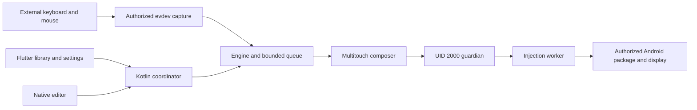

# Architecture and scope

This guide describes the current application. The detailed [module inventory and historical results](../ARCHITECTURE.md) are available in Spanish. Older references to accessibility describe earlier versions: current keyboard and mouse capture and mapper windows do not require an accessibility service.

## Input, windows and processes

Flutter is the control plane. Native modules handle physical samples and touch contacts without passing each event through Dart. Capture selects external devices by capability and acquires them using `EVIOCGRAB`; a lease and independent watchdog allow devices to be released if the consumer is lost. The injection worker runs separately from the guardian.

Injection requires a verified session, target, display and focus. Context loss pauses actions, and injector recovery does not replay held keys or buttons. Presentation windows use Android's standard overlay permission on both the phone and external displays. External calibration includes the window frame; a geometry change requires recalibration. A DeX test does not establish support for every DeX mode or game.

## Profiles, repeat and session closure

Schema 9 stores profiles, calibration, controls, macros and shortcuts. The repository validates documents and writes them atomically; the engine uses prepared configuration and does not read profile files for every movement. The editor uses a draft: Save validates and applies it, while Cancel keeps the previous profile.

Repeat can run while held or as a toggleable loop. Successive presses start and stop the loop; its timer accepts 0–86400 seconds, with zero meaning no limit. Each activation starts a new deadline. A bounded callback controls both pulses and expiry without an additional thread. Pausing, closing or entering cursor mode cancels its tasks and releases contacts. Missed periods are skipped rather than replayed as a burst.

Home offers session closure while a session exists, including blocked or pending closure. Release must be confirmed before another mapping starts. The session closes automatically once both the game task and window are confirmed gone; minimizing or losing focus preserves the paused session. If Android cannot confirm exit, manual closure remains available.

## Activation and updates

The engine can be activated locally through Android wireless debugging, or from a computer using authorized ADB over USB or Wi-Fi. The PC need not remain connected after activation. A hub, keyboard and mouse do not run ADB themselves. See the [phone](ACTIVATE_PHONE.md) and [PC](ACTIVATE_PC.md) activation guides.

Version 0.3.4 changed the Android application ID to `dev.uwumouse.app`, which Android treats as a new app. Profiles must be exported from the old installation and imported into the new one, and permissions granted again. A compatible profile format does not transfer private data between apps. See [migration](MIGRATION_0_3_4.md).

## Performance and validation

The implementation reduces unnecessary wakeups, drawing and layout work, bounds queues and buffers, and cancels work when no longer needed. The optional FPS and battery monitor samples only while visible. The detailed [performance review](../PERFORMANCE_REVIEW.md) remains available in Spanish.

Automated tests, InputLab and observations in games have distinct scopes. InputLab checks touch sequences in its own window; an ACK does not prove an action occurred in a game or a frame was presented. Internal timing percentiles and CPU completion of `onDraw` do not measure physical mouse-to-image latency. The optional `latencyprobe` accessibility experiment is a comparison tool and is not part of the mapper.

The phone repeat test confirmed loop, timer and cancellation with 47 valid events and no pending contacts; it does not certify multi-hour stability. CI results must be checked for each release commit and its published APKs. Profiles and device logs under `evidence/` are excluded from the public repository.
