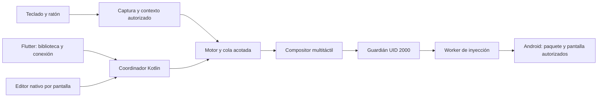

# Arquitectura de UwU Mouse

Esta descripción corresponde a **0.2.0+37**. Flutter gestiona juegos, perfiles, ajustes y estado. Kotlin procesa la entrada, el editor nativo, las transiciones y la composición multitáctil. El paquete Android histórico se conserva para permitir actualizaciones con los mismos datos y autorizaciones cuando la firma coincide.

## Perfiles y edición

El **esquema 9** guarda identidad, nombre, paquete, orientación, dimensiones, área calibrada, joystick, cámara, sensibilidad, acciones, tamaños, macros y atajos. La calibración distingue `phone` y `external` y conserva el marco de la ventana cuando corresponde. El ID numérico de la pantalla se resuelve durante la sesión; no identifica persistentemente un perfil.

Un juego puede tener varios perfiles independientes. Al pasar por primera vez a pantalla externa, se crea una copia separada que exige calibración, sin sobrescribir el perfil del teléfono. La selección prefiere el contexto de pantalla actual; los conflictos de atajos se validan por juego y tipo de pantalla. Cambiar de perfil termina las acciones anteriores y no reproduce entradas mantenidas. Eliminar un perfil requiere confirmación y actualiza de forma atómica la selección y su reemplazo; eliminar el último cierra sus herramientas.

El repositorio es la única fuente de verdad: valida documentos y usa `AtomicFile`. Los esquemas anteriores se migran en memoria sin sobrescribirlos al leer. Guardar es explícito. Antes de iniciar, el compilador convierte el perfil a coordenadas y asignaciones preparadas; **ningún movimiento del ratón consulta archivos o bases de datos**.

El editor usa un borrador. Entrar pausa el mapeo y termina contactos, de modo que los clics usados para editar no se convierten simultáneamente en acciones del juego. Guardar valida y cambia la configuración mediante una transición segura; Cancelar conserva la anterior. Los círculos admiten asignación directa, arrastre, cambio de tamaño y eliminación. La paleta incluye Guardar/Cancelar; los paneles evitan asignadores redundantes y usan barras de 6 dp con área táctil accesible.

La biblioteca muestra el estado de accesibilidad y motor antes de los juegos. Ajustes de conexión ofrece el acceso concreto cuando falta cada servicio. Perfiles aparece primero en la burbuja, cuyo estado queda centrado y cuyo cierre es compacto. La preparación de una ventana puede reutilizar un contexto estable validado; se invalida si cambian la geometría, el destino o el servicio.

## Pantallas, ventanas y coordenadas

La configuración distingue el área calibrada del juego, el marco completo de su ventana y las coordenadas de inyección de la pantalla destino. Un perfil externo confirmado requiere un marco válido que contenga el área. Al iniciar, marco, dimensiones, orientación y tipo de pantalla deben coincidir; mover o redimensionar la ventana suspende y requiere recalibración, aunque algunos controles aún quepan.

El servicio obtiene las ventanas por pantalla y confirma el paquete y el foco del destino. Un broker en el proceso autorizado aporta la información de foco necesaria para DeX. Las ventanas ajenas superiores también cuentan cuando Android las clasifica como ventanas de aplicación, como ocurre con una barra del escritorio: sus regiones bloquean puntos y su foco puede pausar el mapeo. Salir del contexto o perder la pantalla no permite continuar sobre otra app.

En el teléfono se usan superposiciones de accesibilidad. En pantalla externa se usa **TYPE_APPLICATION_OVERLAY** tras la concesión explícita del permiso estándar **SYSTEM_ALERT_WINDOW**, presentado como **Ventanas de DeX** en Ajustes de conexión. Se crea el contexto para la pantalla destino y se comprueba el permiso antes de abrir la sesión o editor. El HUD de controles es solo presentación y no recibe toques. Las capas pasantes limitan su opacidad combinada según el máximo de Android y un presupuesto de tres capas; ese cálculo no sustituye una prueba física de paso de toques.

En DeX, la ventana completa del editor puede hacer que la app cubierta deje de aparecer en el inventario de accesibilidad. Un ancla acotada a perfil, paquete, pantalla y marco conserva **solo la presentación de edición** mientras se mantiene su contexto autorizado. En ese modo no hay captura ni sesión de inyección activa. Cerrar el editor elimina el ancla; jugar exige de nuevo una ventana real y foco fresco del juego. El ancla no congela una autorización de inyección.

## Captura y coste de ruteo

El motor comparte hasta diez contactos entre joystick, cámara, acciones, macros y comandos. La cámara admite movimiento continuo o limitado a región. Repetir se ejecuta mientras se mantiene su activador y cancela tareas al soltar o pausar; los periodos atrasados se omiten, sin acumular ráfagas.

La captura distingue eventos de ratón físicos de entradas táctiles. El Samsung probado entrega una combinación de fuentes MOUSE y TOUCHSCREEN para un ratón externo. Se admite cuando tanto el evento como el dispositivo tienen capacidad MOUSE y el dispositivo es externo y no virtual; no existe una excepción por un identificador concreto. Las entradas táctiles puras y los dispositivos virtuales no obtienen esa excepción. Avisos de dispositivo con capacidades idénticas no interrumpen la sesión; una retirada o cambio material sigue pausando y liberando contactos.

Con varias pantallas, o con un destino externo, se confirma la pantalla real de **cada MotionEvent** mediante una RPC al backend autorizado antes de procesarlo. No se infiere a partir de coordenadas, del nombre del ratón o de su primer evento. Una pantalla distinta o imposible de confirmar pausa y retira la captura. Se hace una consulta por evento, no por cada muestra histórica; esta RPC añade coste al camino de entrada y se mide aparte. La ruta telefónica de una sola pantalla conserva su recorrido habitual.

## Activación, estados y recuperación

El backend se prepara mediante ADB autorizado como UID 2000 y comprueba el permiso efectivo de inyección. La activación local usa descubrimiento mDNS, emparejamiento TLS con el código de Android y un comando fijo para arrancar las clases del APK instalado. La notificación permite introducir el código sin cerrar el diálogo de emparejamiento. Si no existe una actividad directa de Depuración inalámbrica, se abren Opciones de desarrollador. La app requiere Android 14/API 34 o posterior. [Guía local](ACTIVAR_TELEFONO.md), [alternativa PC](ACTIVAR_PC.md).

La identidad se guarda en archivos privados con escritura atómica y cifrado AES-GCM mediante Android Keystore; el código de seis dígitos solo se usa en memoria. La activación se restringe al mismo teléfono y no expone un terminal de comandos arbitrarios. Se reconecta un guardián vivo antes de arrancar otro y se exige sesión cerrada, ausencia de contactos y liberación verificada. Cancelar cierra el transporte de activación, sin detener un guardián ya activo.

No requiere root ni InputLab instalado. El arranque del motor no abre una sesión ni un juego. Tocar un juego puede reactivar el motor con la identidad guardada si Depuración inalámbrica sigue disponible; esa acción exige la pulsación del usuario. Después de un reinicio puede hacer falta reactivarlo. Accesibilidad sigue siendo necesaria para la captura y coordinación de esta implementación.

Los modos distinguen detenido, edición, juego, recuperación y bloqueo. El guardián conserva la secuencia activa, su pantalla original y los datos necesarios para reemplazar el worker y cancelar contactos sin reiniciar al receptor. Solo se cambia el destino con el journal vacío y la liberación verificada. Si se pierde completamente la capacidad de inyección, no se puede garantizar una cancelación: se mantiene el bloqueo y no se continúa inyectando.

Detener libera la captura, restaura el puntero del sistema y retira las ventanas de sesión. Mantener accesibilidad autorizada no significa consumir entradas fuera de una sesión. Pausar, editar, perder contexto o recuperar el worker no reproduce teclas o botones que seguían mantenidos.

## Verificación y límites

La prueba real de 0.2.0+37 corresponde a **Samsung con Android 14, DeX por HDMI, pantalla completa a 1920×1080 y Free Fire en Entrenamiento**. Con teclado y ratón físicos, el usuario confirmó movimiento, cámara y acciones, incluida la mira, también después de editar/guardar y volver a abrir el juego desde la interfaz. Los registros del mapeador describen su propio procesamiento; no leen eventos internos del juego, y un ACK de inyección no prueba por sí solo que una acción haya ocurrido.

InputLab aporta evidencia independiente de secuencias, liberaciones parciales, F8/F9 y retirada OTG. La recuperación en DeX se probó con un fallo sintético del worker y cancelación real recibida con tres contactos; no es una caída física observada en el juego. El ensayo OTG no aísla continuidad de HDMI durante la operación. Las suites automatizadas cubren perfiles, persistencia, migración, coordenadas, contexto, selección y transiciones; el [workflow Android](CI_ANDROID.md) añade análisis, pruebas y APK por ABI.

La reapertura física del perfil reciente fue una vuelta por Activity/UI con el repositorio conservado en memoria. **No se presenta como reinicio frío del proceso ni como lectura de disco observada.** Esa prueba posterior, WirelessDeX, DeX para PC, ventanas movidas o redimensionadas, otras orientaciones o juegos y todos los botones/macros de cada perfil siguen sin validación física específica.

### Referencia de rendimiento

Una muestra estable de 10.464 s con editor cerrado, sin grabación y con entradas de ratón midió únicamente procesos propios:

| Proceso | CPU equivalente a un núcleo |
|---|---:|
| App | 10.03% |
| Guardián | 13.67% |
| Inyector | 4.49% |

La suma fue 28.19% de un núcleo; los procesos del juego se excluyeron. Hubo 896 muestras relativas y 897 inyecciones, sin nuevos bordes de teclado durante el intervalo. La cola tuvo máximo 2 y terminó en 0. Los percentiles internos rodantes del mismo SID fueron p95 de cola 0.574 ms e IPC 6.568 ms; no se limitan al intervalo de CPU. El ruteo de 897 eventos costó una media de 0.563 ms por RPC en una ventana diagnóstica de 12.164 s, distinta de la muestra de CPU.

Estas cifras incluyen instrumentación y observación ADB, no son latencia hasta imagen ni FPS y no permiten comparar causalmente con 0.1.1. Una referencia de reposo sin entradas se mantiene separada; cero ticks observados a la resolución del muestreo no significa coste cero. La medición breve tampoco acredita rendimiento sostenido o compatibilidad universal.
