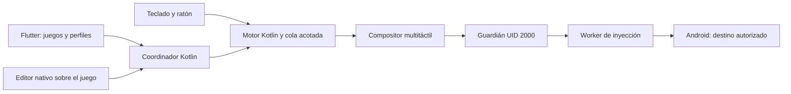

# Arquitectura de UwU Mouse

UwU Mouse procesa teclado y ratón localmente en Android. Flutter sirve para la biblioteca, los perfiles y los ajustes generales. Un servicio de accesibilidad y código Kotlin gestionan la captura autorizada, el editor nativo y las transiciones de sesión. El nombre histórico del paquete se conserva para mantener la identidad de las instalaciones existentes.

## Perfiles y edición

Cada perfil tiene identidad propia, nombre, paquete de destino, versión de esquema, orientación y calibración. Guarda joystick, región y sensibilidad de cámara, acciones, tamaños, macros y atajos. Varios perfiles pueden pertenecer al mismo juego y conservar mapeos independientes.

El almacén local usa una única representación validada y escritura atómica. Las versiones anteriores se migran al cargar sin sobrescribirlas implícitamente. Antes de iniciar, se compila el perfil a coordenadas y bindings preparados; los eventos de ratón no leen archivos ni bases de datos.

El editor modifica un borrador. Entrar en edición pausa el mapeo y libera contactos; los clics de edición no se convierten a la vez en acciones del juego. Guardar valida y aplica mediante una transición segura; Cancelar conserva el perfil anterior. La paleta incluye los controles y sus comandos de Guardar/Cancelar.

Las teclas opcionales de selección de perfil se validan contra las asignaciones del juego y entre perfiles para evitar que una tecla cambie el perfil y ejecute simultáneamente un mapeo. Cambiar de perfil termina las acciones anteriores y no reproduce teclas que seguían mantenidas.

## Estados y destino

Los modos distinguen detenido, edición, juego, recuperación y bloqueo. El destino debe estar confirmado por el contexto de ventanas, paquete y calibración. Una ventana del editor propio se diferencia de un cambio de aplicación. Salir del contexto, perder la pantalla o invalidar la orientación pausa el motor.

La burbuja y los controles visibles son ventanas de accesibilidad propias. El HUD de mapeos es solo presentación, no recibe toques. Restaurar la presentación al volver al destino no reanuda automáticamente la sesión o las entradas mantenidas.

## Entrada y recuperación

El motor comparte un compositor de hasta diez contactos entre joystick, cámara, acciones, macros y comandos. Repetir funciona mientras se mantiene su activador y cancela las tareas al soltar o pausar. Sus intervalos son nominales: los periodos atrasados se omiten en vez de acumular una ráfaga.

El backend se activa mediante ADB autorizado como UID 2000 y comprueba el permiso efectivo de inyección. No se necesita root. El guardián conserva la secuencia y el estado necesario para sustituir al worker y emitir la cancelación correspondiente sin reiniciar al receptor. Si se pierde por completo la capacidad de inyección, la app no puede garantizar la cancelación: mantiene la sesión bloqueada y no continúa inyectando.

Detener retira la captura y las superposiciones de sesión. Que el servicio de accesibilidad siga autorizado no significa que deba consumir teclado o ratón cuando no hay una sesión activa.

## Verificación

Las pruebas Kotlin cubren validación, persistencia, coordenadas, transiciones, composición y recuperación. InputLab es un receptor Android independiente que permite observar eventos y contactos de una secuencia. Las pruebas Flutter cubren el contrato del canal nativo y recorridos de la biblioteca.

Los juegos cerrados se evalúan por comportamiento visible y registros del propio mapeador; no se atribuyen lecturas de eventos internos al juego. Un ACK del inyector no demuestra que haya ocurrido la acción esperada. Las latencias de cola o IPC son internas, no latencia completa hasta imagen. El [workflow Android](CI_ANDROID.md) comprueba la compilación y las pruebas automatizadas, y genera APK separados por ABI.
