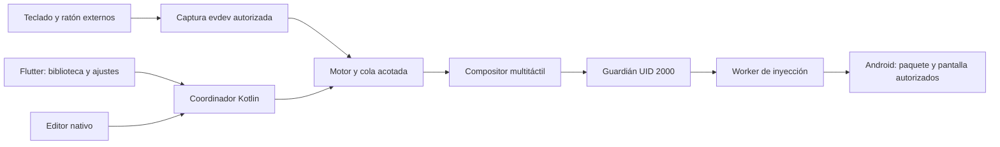

# Arquitectura pública y alcance de UwU Mouse

Esta descripción resume la aplicación actual. El inventario de módulos,
contratos y resultados históricos está en [ARCHITECTURE.md](../ARCHITECTURE.md).
Los detalles de accesibilidad de las primeras versiones no describen el APK
actual: la captura de teclado y ratón y las ventanas del mapeador ya no requieren
un servicio de accesibilidad.

## Entrada, ventanas y procesos

Flutter es el plano de control. Las muestras físicas y los contactos táctiles
se procesan en los módulos nativos, sin pasar por Dart en cada evento. La captura
selecciona dispositivos externos por sus capacidades y los adquiere mediante
`EVIOCGRAB`; una lease y un watchdog independiente permiten devolverlos si se
pierde el consumidor. El inyector mantiene su proceso separado del guardián.

La inyección exige sesión, destino, pantalla y foco verificados. La pérdida de
contexto pausa las acciones; una recuperación del inyector no reproduce teclas
o botones mantenidos. Las ventanas de presentación usan el permiso estándar
**Mostrar sobre otras apps** tanto en teléfono como en pantallas externas. La
calibración externa conserva el marco de la ventana y exige recalibrar si cambia
su geometría. Ninguna prueba en DeX acredita por sí sola todos sus modos o juegos.

## Perfiles, bucles y cierre

El esquema 9 conserva perfiles, calibración, controles, macros y atajos. El
repositorio valida los documentos y usa escritura atómica; el motor consume una
configuración preparada y no lee archivos por movimiento. El editor usa un
borrador: Guardar valida y aplica; Cancelar conserva el perfil anterior.

**Repetir** funciona al mantener pulsado o mediante **Mantener en bucle**. Una
pulsación inicia el bucle y otra lo detiene; el temporizador acepta 0–86400
segundos y `0` deja el bucle sin límite. Cada activación inicia un plazo nuevo.
El mismo callback acotado controla pulsos y vencimiento, sin hilos adicionales.
Pausar, cerrar o entrar al cursor cancela sus tareas y libera los contactos; los
periodos perdidos se omiten sin producir una ráfaga posterior.

Inicio conserva **Cerrar sesión** mientras existe una sesión, también durante
bloqueos o cierres pendientes. La liberación debe confirmarse antes de iniciar
otro mapeo. La desaparición confirmada de la tarea y ventana del juego cierra la
sesión automáticamente; minimizar o perder foco conserva la pausa. Si Android
no permite confirmar la salida, se conserva el cierre manual.

## Activación y actualización

La activación local usa el emparejamiento de Depuración inalámbrica de Android.
También puede arrancarse desde un equipo con ADB por USB o Wi-Fi; después de
activar no hace falta mantener la PC conectada. El hub, ratón y teclado no
ejecutan ADB por sí solos. [Activar en el teléfono](ACTIVAR_TELEFONO.md) ·
[Activar desde PC](ACTIVAR_PC.md).

La identidad Android de 0.3.4 es **`dev.uwumouse.app`**. Android la considera una
app nueva respecto a la instalación anterior: exporta los perfiles antes de
cambiar, impórtalos después y vuelve a conceder permisos. El formato compatible
del perfil no transfiere automáticamente los datos privados entre aplicaciones.
[Migración](MIGRACION_0_3_4.md).

## Rendimiento y validación

La revisión elimina despertares, dibujados y relayouts redundantes, mantiene
colas y buffers acotados y cancela trabajo cuando deja de ser necesario.
El monitor de FPS y batería es opcional y consulta solo mientras se muestra.
[Revisión y límites de rendimiento](../PERFORMANCE_REVIEW.md).

Las pruebas automáticas, InputLab y las observaciones en juegos tienen alcances
separados. InputLab valida secuencias táctiles en su propia ventana; un ACK no
demuestra una acción dentro de un juego ni la presentación de un frame. Los
percentiles internos y la terminación CPU de `onDraw` no miden la latencia desde
el movimiento físico hasta la imagen. `latencyprobe` conserva un experimento
opcional de accesibilidad para comparar rutas y no forma parte del mapeador.

La prueba de repetición en el teléfono confirmó el bucle, su temporizador y
cancelación con 47 eventos válidos y cero contactos pendientes. No certifica
estabilidad durante varias horas. Las ejecuciones de CI deben comprobarse sobre
el commit final y los APK publicados de cada versión. Los perfiles y registros
del dispositivo permanecen en `evidence/`, excluido del repositorio público.
